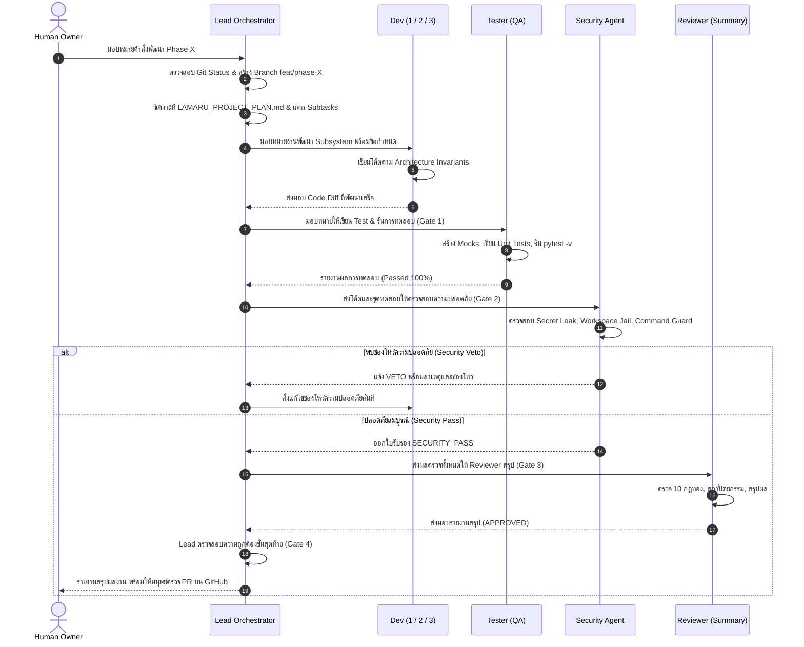

# Lamaru Multi-Agent Team Framework (โครงสร้างทีมพัฒนาแบบ Multi-Agent)

> **หลักการสำคัญ:**  
> **"มนุษย์ (Project Owner) คือผู้กำหนดทิศทางและตัดสินใจสถาปัตยกรรม — AI หลัก (Lead Orchestrator) คุมทีมและแจกจ่ายงาน — ลูกน้องเฉพาะทาง (Devs, Tester, Security, Reviewer) ปฏิบัติการตามกฎทองอย่างเคร่งครัด"**

---

## 1. ภาพรวมสถาปัตยกรรมทีม (Team Architecture Overview)

เพื่อให้การพัฒนา **Lamaru AI Gateway** ใน Phase ถัดไป (Phase 16 ถึง 27) ดำเนินไปอย่างมีระเบียบ ปลอดภัยสูงสุด และไม่มีช่องโหว่ร้ายแรงเกิดขึ้น เราจึงจัดโครงสร้างทีม AI ออกเป็นบทบาทเฉพาะทาง (Specialized Agent Team) พร้อมระบบ **ความปลอดภัย 4 ด่าน (Four-Gate Quality & Security System)**:

```text
                  +-----------------------------------+
                  |      Human (Project Owner)        |
                  +-----------------+-----------------+
                                    | กำหนด Phase & อนุมัติ PR
                                    v
                  +-----------------------------------+
                  |  Lead Orchestrator (AI หลักคุมทีม) |
                  |  - วางแผนงานย่อย (Task Breakdown) |
                  |  - ควบคุม Architecture Invariants |
                  |  - แจกจ่ายงานและติดตามสถานะ       |
                  +-----------------+-----------------+
                                    |
          +-------------------------+-------------------------+
          |                         |                         |
          v                         v                         v
+-------------------+     +-------------------+     +-------------------+
|       Dev 1       |     |       Dev 2       |     |       Dev 3       |
|  (Core & Engine)  |     | (Tools & Gateway) |     |  (Data & Platform)|
| - Phase 16 (Loop) |     | - Phase 20 (MCP)  |     | - Phase 18 (SQLite|
| - Phase 17 (Model |     | - Gateway/OpenAI  | - Phase 19 (CLI)  |
|   Switching)      |     | - Tool Security   | - Observability   |
+---------+---------+     +---------+---------+     +---------+---------+
          |                         |                         |
          +-------------------------+-------------------------+
                                    | ส่งมอบ Code Diff
                                    v
                  +-----------------------------------+
                  |      Tester (QA Specialist)       |
                  |  - เขียน Test ครอบคลุม 100%       |
                  |  - ห้ามยิง API จริง (Mock Only)   |
                  |  - ตรวจสอบ Edge Cases & Pytest    |
                  +-----------------+-----------------+
                                    | ผล Test ผ่าน 100%
                                    v
                  +-----------------------------------+
                  |     Security (Security Auditor)   |
                  |  - ตรวจสอบ Threat Modeling        |
                  |  - สกัดกั้น Secret Leakage        |
                  |  - ตรวจ Workspace/Command Guard   |
                  |  - ออกสิทธิ์ SECURITY_PASS / VETO |
                  +-----------------+-----------------+
                                    | ได้รับ SECURITY_PASS
                                    v
                  +-----------------------------------+
                  |   Reviewer (Final Review & QA)    |
                  |  - สรุปผลรีวิวโค้ด สถาปัตยกรรม    |
                  |  - รวบรวมรายงาน Security & Test   |
                  |  - ให้คำวินิจฉัย APPROVED         |
                  +-----------------+-----------------+
                                    | สรุปผลการตรวจทาน
                                    v
                  +-----------------------------------+
                  |  Lead Orchestrator (AI หลักคุมทีม) |
                  |  - ตรวจสอบความสมบูรณ์ขั้นสุดท้าย   |
                  |  - ยืนยัน Git Branch & Status     |
                  |  - นำเสนอ Human Owner ตรวจ PR     |
                  +-----------------+-----------------+
```

---

## 2. บทบาทและหน้าที่ของ Agent แต่ละตัว (Team Roles & Responsibilities)

| บทบาท | ไฟล์นิยาม | หน้าที่หลัก | ขอบเขตความรับผิดชอบ |
| :--- | :--- | :--- | :--- |
| **Lead Orchestrator** (AI หลัก) | [`orchestrator.md`](./orchestrator.md) | ผู้จัดการทีม & สถาปนิก | วางแผนงาน, แตก Task, มอบหมายงาน, คุม Branch, ตรวจสอบ Gate ทั้ง 4 ด่าน, สรุปผลให้เจ้าของโปรเจกต์ |
| **Security** (ความปลอดภัย) | [`security.md`](./security.md) | ตรวจสอบความปลอดภัยและช่องโหว่ | ตรวจสอบ Threat Modeling, ป้องกัน Secret Leaks, ตรวจสอบ `WorkspaceGuard` / `CommandGuard`, ออกสิทธิ์ `SECURITY_PASS` หรือ `SECURITY_VETO` |
| **Reviewer** (ผู้สรุปการรีวิว) | [`reviewer.md`](./reviewer.md) | สรุปผลการตรวจทานโค้ดและคุณภาพ | ตรวจ Code Diff เทียบกับ 10 กฎทอง, สรุปผลความปลอดภัยและผลเทสต์, วินิจฉัย `APPROVED` หรือ `CHANGES_REQUESTED` |
| **Tester** (ผู้ทดสอบ) | [`tester.md`](./tester.md) | ประกันคุณภาพและเขียน Unit Test | ออกแบบ Mock, เขียน Test ครอบคลุม, รัน Pytest ทั้งหมด, รับรองว่าไม่มี Regression และห้ามยิง Provider จริง |
| **Dev 1 (Core)** | [`dev1_core.md`](./dev1_core.md) | พัฒนาระบบแกนกลาง (Core Engine) | รับผิดชอบ `AgentLoop` (Phase 16), Model Switching (Phase 17), State Machine (`src/lamaru/agent/`), Router & Resilience |
| **Dev 2 (Tools & Gateway)** | [`dev2_tools_gateway.md`](./dev2_tools_gateway.md) | พัฒนาส่วนเชื่อมต่อและเครื่องมือ | รับผิดชอบ Tool System, Workspace/Command Guard (`src/lamaru/tools/`), FastAPI Gateway (`src/lamaru/gateway/`), MCP Protocol (Phase 20) |
| **Dev 3 (Data & Platform)** | [`dev3_platform_data.md`](./dev3_platform_data.md) | พัฒนาฐานข้อมูล, CLI & สภาพแวดล้อม | รับผิดชอบ SQLite Persistence (Phase 18), CLI `lamaru` (Phase 19), Extension Integration (Phase 21), Observability (Phase 22) |

---

## 3. วงจรการทำงานประจำ Phase (Phase Lifecycle Workflow)

เมื่อเริ่มต้นพัฒนา Phase ใหม่ ให้ปฏิบัติตามลำดับขั้น 4 ด่าน (Four-Gate System) ดังนี้อย่างเคร่งครัด:



---

## 4. มาตรฐานความปลอดภัยและคุณภาพ (Quality & Security Governance)

1. **Gate 1 (Dev & Test):** โค้ดเสร็จสมบูรณ์ + Unit Tests ผ่าน 100% ปราศจาก Regression (ห้ามเรียก Real API)
2. **Gate 2 (Security):** ผ่านการตรวจสอบจาก `Security Agent` และได้รับสถานะ `SECURITY_PASS` เท่านั้น
3. **Gate 3 (Review):** ได้รับการสรุปและอนุมัติ `APPROVED` จาก `Reviewer`
4. **Gate 4 (Lead & Owner):** `Lead Orchestrator` ตรวจสอบ Git Status, Commit ตามมาตรฐาน และส่งต่อให้ `Human Owner` ตรวจสอบ Pull Request บน GitHub
