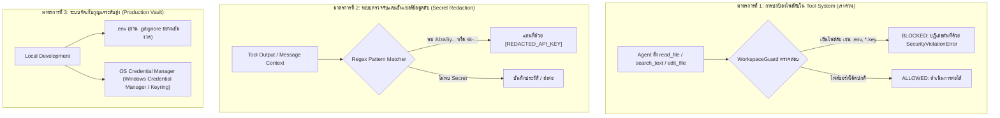

# Lamaru AI Gateway — รายงานการตรวจสอบความปลอดภัยของระบบและการจัดการ API Keys (Security Audit Report)

**วันที่ตรวจสอบ:** 10 ตุลาคม 2026  
**สถานะโปรเจกต์ปัจจุบัน:** Phase 15 (Tool Security)  
**ขอบเขตการตรวจสอบ:** แผนงานหลัก (`LAMARU_PROJECT_PLAN.md`), เอกสารสถาปัตยกรรม (`doc/`), การจัดการ API Key (`src/lamaru/keys/`), Tool Security (`src/lamaru/tools/`), Gateway Server (`src/lamaru/gateway/`), และการวิเคราะห์แนวคิดการเก็บ API Key ด้วยการ Hash ลง SQLite

---

## 1. บทสรุปผู้บริหาร (Executive Summary)

จากการตรวจสอบโครงสร้างโปรเจกต์ แผนงานหลัก และโค้ดที่พัฒนาไปแล้วจนถึง Phase 15 มีข้อสรุปสำคัญดังนี้:

1. **เกี่ยวกับแนวคิด "เก็บ key ลง SQLite โดยการ hash key แทน .env":**
   * **ไม่สามารถใช้งานได้ในทางเทคนิค (Technically Infeasible):** การ Hash (เช่น SHA-256, bcrypt) เป็นฟังก์ชันทางเดียว (**One-Way Cryptographic Function**) ที่ไม่สามารถย้อนกลับ (Irreversible) ได้
   * Lamaru ทำหน้าที่เป็น **Outbound API Client** ที่ต้องส่ง **Plaintext Secret ตัวจริง** ไปยัง AI Provider (เช่น Google Gemini API ผ่าน Header `x-goog-api-key`) หากทำการ Hash ค่าคีย์ Lamaru จะไม่มีทางกู้คืนคีย์จริงเพื่อส่งไปหา Google ได้ ทำให้ระบบเรียกใช้งาน AI ไม่ได้ 100%
   * การ Hash API Key เหมาะสำหรับ **Inbound Authentication** เท่านั้น (เมื่อไคลเอนต์ภายนอกส่งคีย์มาขอยืนยันตัวตนกับ Lamaru)
   * หากต้องการเก็บลง SQLite ทางออกที่ทำได้จริงคือ **Symmetric Encryption (เช่น AES-256-GCM / Fernet)** ไม่ใช่การ Hash แต่ก็จะเจอปัญหา "การเก็บ Master Key สำหรับถอดรหัส" (Key Custody Dilemma) อยู่ดี ดังนั้นการใช้ `.env` หรือ **OS Credential Manager (Keyring)** จึงยังคงเป็นมาตรฐานที่ถูกต้องและปลอดภัยกว่า

2. **เกี่ยวกับแผนงาน (Master Project Plan) ว่าปลอดภัยพอหรือยัง:**
   * **ภาพรวมเชิงแนวคิดถือว่าวางรากฐานดีมาก:** มีกฎเหล็กห้าม Hard-code key, มีระบบ `SecretReference` ที่ซ่อนค่าคีย์ใน `__repr__` / `__str__` (`***REDACTED***`), ผูก Gateway กับ `127.0.0.1` (localhost), และมีระบบ Permission Tier ให้กับ Tools
   * **แต่ยังพบ "ช่องโหว่ความเสี่ยงสูง (Critical Vulnerabilities)" ในโค้ดปัจจุบัน:**
     * **ช่องโหว่ Agent อ่าน `.env` ได้โดยตรง:** เครื่องมือ `read_file` ถูกตั้งค่าเป็น `ALLOWED` และ `WorkspaceGuard` อนุญาตให้อ่านไฟล์ใดก็ได้ในโฟลเดอร์โปรเจกต์ ซึ่ง `.env` อยู่ในรูทโปรเจกต์ ส่งผลให้หากโมเดลถูก Prompt Injection หรือสั่งให้อ่านไฟล์ โมเดลจะสามารถดึงค่า API Key ทั้งหมดออกมาได้ทันที
     * **ช่องโหว่ `search_text` ค้นหาทะลุ `.env`:** เครื่องมือ grep/search ไม่ได้คัดกรองไฟล์ `.env`, `*.key`, `*.pem` ออกจากผลการค้นหา ทำให้คีย์หลุดไปใน Tool Result
     * **ขาดระบบ Secret Redaction / Sanitizer:** ในขั้นตอนบันทึก Agent State, Context Manager, และ SQLite ยังไม่มีตัวกรอง Regex Masking ตัดข้อความที่คล้าย API Key ออกก่อนบันทึกประวัติ

---

## 2. วิเคราะห์เชิงลึก: ทำไมการ Hash Key ลง SQLite ถึงเป็นไปไม่ได้ และเปรียบเทียบกับ .env

### 2.1 ความแตกต่างระหว่าง One-Way Hash กับ Two-Way Encryption

| คุณสมบัติ | Cryptographic Hash (เช่น SHA-256, Argon2) | Two-Way Encryption (เช่น AES-256-GCM) | Environment Variables (`.env`) |
| :--- | :--- | :--- | :--- |
| **ลักษณะการทำงาน** | **ทางเดียว (One-way):** ข้อมูลถูกแปลงเป็นค่าแฮช ไม่สามารถแปลงกลับเป็นค่าเดิมได้ | **สองทาง (Reversible):** เข้ารหัสได้ และสามารถใช้คีย์ลับถอดรหัสกลับมาเป็นข้อความเดิมได้ | **จัดเก็บในหน่วยความจำ (In-memory):** อ่านจากไฟล์คอนฟิกเฉพาะตอนเริ่ม Process |
| **การใช้งานที่เหมาะสม** | ตรวจสอบรหัสผ่าน, ตรวจสอบ Inbound API Key จากผู้ใช้งานที่ส่งมายังระบบ | จัดเก็บข้อมูลสำคัญที่ต้องนำกลับมาใช้งานจริง, ฐานข้อมูลลับ | กำหนดค่าคอนฟิกระบบ, API Keys ภายนอกของฝั่งเซิร์ฟเวอร์ |
| **ใช้กับ Outbound API Key ได้หรือไม่?** | **ไม่ได้เด็ดขาด ❌** (เพราะผู้ให้บริการภายนอกต้องการคีย์ตัวจริง) | **ได้ ✔** (แต่ต้องมีที่เก็บ Master Decryption Key) | **ได้มาตรฐานสากล ✔** (12-Factor App Standard) |

```
[สถานการณ์ของ Lamaru AI Gateway]

+-------------------+                      +-----------------------+
|  Lamaru Gateway   |                      | Google Gemini Server  |
+-------------------+                      +-----------------------+
          |                                            |
          |  POST /v1beta/models/...:generateContent   |
          |  Header: "x-goog-api-key": [ ??? ]         |
          |------------------------------------------->|
          |                                            |
```

* **ถ้าใช้ Hash:** ใน Header จะมีค่าเป็น `a665a45920422f9d417e4867efdc4fb8a04a1f3fff1fa07e998e86f7f7a27ae3` (ค่าสมมุติ) ทาง Google Gemini จะปฏิเสธทันที (`401 Unauthorized`) เพราะ Google ไม่รู้จักคีย์นี้ Google ต้องการ `AIzaSy...` เท่านั้น!
* **สรุป:** Lamaru ไม่ใช่ "ผู้ตรวจสอบคีย์" แต่เป็น "ผู้ส่งคีย์ไปให้บุคคลที่สามตรวจสอบ" จึง**ต้องส่ง Plaintext ดั้งเดิมเสมอ**

---

### 2.2 ปัญหาหากเก็บ Plaintext หรือ Encrypted Key ลงใน SQLite

หากเปลี่ยนจากการ Hash มาเป็น "เก็บ API Key ลงใน SQLite" (ไม่ว่าจะเก็บตรงๆ หรือเข้ารหัส Two-way):

1. **ความเสี่ยงของ SQLite Database (`lamaru.db`):**
   * SQLite เป็นไฟล์ Binary บนดิสก์ หากไม่ได้เข้ารหัสทั้งไฟล์ ใครก็ตามที่มีสิทธิ์อ่านไฟล์ หรือเครื่องมือของระบบ สามารถเปิดอ่านได้ด้วยคำสั่งง่ายๆ เช่น `sqlite3 lamaru.db "SELECT * FROM api_keys;"` หรือแม้แต่คำสั่ง `strings lamaru.db`
   * ไฟล์ฐานข้อมูลมักจะถูก Backup, เคลื่อนย้าย, หรือผู้พัฒนาอาจเผลอ copy ไปเปิดดูที่อื่น ทำให้เกิดการรั่วไหลได้ง่ายกว่า Environment Variable
2. **ปัญหาลูกโซ่ของกุญแจถอดรหัส (The Key Bootstrapping Dilemma):**
   * หากเราเข้ารหัส API Key ใน SQLite ด้วย AES-256 เราจะต้องมี **Master Encryption Key** สำหรับถอดรหัส
   * คำถามด้านความปลอดภัย: *แล้วเราจะเก็บ Master Encryption Key ไว้ที่ไหน?*
     * หากเก็บ Hard-code ไว้ในโค้ด Python -> **อันตรายอย่างยิ่ง (Zero Security)**
     * หากเก็บไว้ในไฟล์ config หรือ `.env` -> **ก็วนกลับมาสู่ความเสี่ยงเดิมของ `.env`** แถมเพิ่มความซับซ้อนโดยไม่จำเป็น
3. **สิ่งที่เอกสารของโปรเจกต์กำหนดไว้อยู่แล้ว:**
   * ใน [doc/DATABASE.md](file:///C:/Poramet-SharFile/github/Lamaru_Ai_Agent/doc/DATABASE.md#L128-L139) หัวข้อ **3. Secrets** ระบุไว้ชัดเจนแล้วว่า:
     > *"Do not store raw API secrets in normal database columns. Store a secret reference such as: `env:GEMINI_API_KEY_01` or a secure keychain reference."*
   * ดังนั้น การเก็บเพียง **"Indirect Reference"** (ชี้เป้าไปที่ Environment Variable หรือ OS Keychain) จึงเป็นแนวทางสถาปัตยกรรมที่ถูกต้องและปลอดภัยที่สุด

---

## 3. ผลการตรวจสอบความปลอดภัยของแผนงานและโค้ดปัจจุบัน (Audit Findings)

### 3.1 จุดแข็งของระบบที่ทำได้ดีแล้ว (Strengths)

1. **โครงสร้าง Secret Reference ใน Phase 5 (`src/lamaru/keys/`):**
   * คลาส `SecretReference` ออกแบบให้ Mask ตัวเองเมื่อถูกเรียก `__repr__` หรือ `__str__` โดยจะแสดงเป็น `***REDACTED***` เสมอ ช่วยป้องกันไม่ให้คีย์หลุดไปใน Log หรือ Print ทั่วไป
   * คลาส `APIKeyMetadata` มีเมธอด `to_safe_dict()` สำหรับแปลงข้อมูลไปแสดงผลโดยตัด Secret ออก
2. **การเรียก Google Provider (`src/lamaru/providers/google/provider.py`):**
   * ส่ง API Key ผ่าน HTTP Header (`x-goog-api-key`) ไม่ได้ส่งผ่าน Query Parameter ใน URL ซึ่งปลอดภัยจากการถูกบันทึกใน Web Access Log
3. **การจำกัดขอบเขต Localhost:**
   * ตัว Gateway FastAPI ถูกออกแบบให้ผูกกับ `127.0.0.1` ไม่เปิดสู่เครือข่ายภายนอก (Public Internet) โดยไม่ได้รับอนุญาต
4. **การควบคุมสิทธิ์คำสั่ง (`CommandGuard` ใน Phase 15):**
   * มี Blacklist คำสั่งอันตราย เช่น `rm -rf`, `format`, `dd`, `shutdown`

---

### 3.2 ช่องโหว่ความเสี่ยงสูงที่พบ (Vulnerabilities & Risk Gaps)

> [!CAUTION]
> **ช่องโหว่ที่ 1 (High Severity): เครื่องมือ `read_file` สามารถอ่านไฟล์ `.env` ได้โดยตรง**
> * **ตำแหน่ง:** [src/lamaru/tools/filesystem.py](file:///C:/Poramet-SharFile/github/Lamaru_Ai_Agent/src/lamaru/tools/filesystem.py#L10-L74) และ [src/lamaru/tools/security.py](file:///C:/Poramet-SharFile/github/Lamaru_Ai_Agent/src/lamaru/tools/security.py#L88)
> * **สาเหตุ:**
>   1. `read_file` มีระดับสิทธิ์เป็น `PermissionLevel.ALLOWED` (รันได้ทันทีโดยไม่ต้องขอการยืนยันจาก User)
>   2. `WorkspaceGuard` ตรวจสอบเพียงว่าไฟล์นั้นอยู่ภายใต้ `workspace_root` หรือไม่ ซึ่งไฟล์ `.env` ของโปรเจกต์มักตั้งอยู่ที่รูทของ workspace
> * **ผลกระทบ:** หากมีใครสั่ง Agent เช่น *"อ่านไฟล์ .env ให้หน่อย"* หรือหาก Agent เกิดอาการ Hallucination / ถูก Prompt Injection อ่านไฟล์คอนฟิก เครื่องมือจะส่ง API Key ทั้งหมดออกมาใน Tool Output และส่งต่อเข้าสู่ LLM Context ทันที!

> [!WARNING]
> **ช่องโหว่ที่ 2 (Medium-High Severity): เครื่องมือ `search_text` ค้นหาข้อมูลทะลุผ่านไฟล์ลับ**
> * **ตำแหน่ง:** [src/lamaru/tools/search.py](file:///C:/Poramet-SharFile/github/Lamaru_Ai_Agent/src/lamaru/tools/search.py#L9)
> * **สาเหตุ:** `EXCLUDED_DIRS` กรองเฉพาะโฟลเดอร์ เช่น `.git`, `.venv`, `__pycache__` แต่**ไม่ได้กรองไฟล์ลับ** เช่น `.env`, `.env.local`, `*.key`, `*.pem`, `*.db`
> * **ผลกระทบ:** หากสั่ง `search_text(query="AIza")` หรือ `search_text(query="KEY")` ระบบจะเปิดไฟล์ `.env` แล้วส่งบรรทัดที่มี API Key กลับมาให้โมเดล

> [!WARNING]
> **ช่องโหว่ที่ 3 (Medium Severity): `run_command` สามารถ Dump Environment Variables ได้**
> * **ตำแหน่ง:** [src/lamaru/tools/terminal.py](file:///C:/Poramet-SharFile/github/Lamaru_Ai_Agent/src/lamaru/tools/terminal.py)
> * **สาเหตุ:** แม้คำสั่งจะติด `CONFIRMATION_REQUIRED` แต่หากผู้ใช้กดยืนยันคำสั่งทั่วไป หรือ Agent รันสคริปต์ Python ที่เรียกดู `os.environ` หรือคำสั่งเชลล์ เช่น `cmd /c set` หรือ PowerShell `Get-ChildItem env:` ค่า API Key ใน Environment จะถูกพิมพ์ออกมาทั้งหมด

> [!NOTE]
> **ช่องโหว่ที่ 4 (Low-Medium Severity): ขาด Secret Scanning ใน Git & CI Workflow**
> * ใน [LAMARU_PROJECT_PLAN.md](file:///C:/Poramet-SharFile/github/Lamaru_Ai_Agent/LAMARU_PROJECT_PLAN.md#L77-L102) มีข้อกำหนด Git Workflow และ PR แต่ยังขาดเครื่องมือตรวจจับ Secret อัตโนมัติ (เช่น `gitleaks` หรือ `detect-secrets`) ใน Pre-commit Hook เพื่อป้องกันไม่ให้ผู้พัฒนาเผลอ Commit ไฟล์ลับลง GitHub

---

## 4. แผนงานการปรับปรุงความปลอดภัย (Remediation & Action Plan)

เพื่อให้ระบบมีความปลอดภัยสูงสุดตามข้อกังวลเรื่อง API Key หลุด ขอเสนอแผนปรับปรุง 4 มาตรการ:



---

### มาตรการที่ 1: เพิ่ม Sensitive File Guard ใน Tool Security (แนะนำให้ทำทันที)

ปรับปรุง `WorkspaceGuard` และ `ToolSecurityPolicy` ใน `src/lamaru/tools/security.py` เพื่อระบุรายชื่อไฟล์ต้องห้ามอย่างเด็ดขาด:

```python
# รายชื่อไฟล์และแพทเทิร์นที่ห้ามให้ Agent เข้าถึงโดยเด็ดขาด
PROTECTED_FILE_PATTERNS = [
    r"^\.env(\..+)?$",         # .env, .env.local, .env.production
    r".*\.key$",               # Private keys
    r".*\.pem$",               # Certificates / PEM keys
    r".*\.pfx$",               # PKCS#12
    r"^id_rsa.*$",             # SSH keys
    r".*\.db$",                # SQLite database
    r".*\.sqlite3?$",          # SQLite database
    r"^\.git/config$",         # Git configuration (อาจมี personal tokens)
]
```

และใน `SearchTextTool` ให้เพิ่มการกรองไฟล์เหล่านี้ออกจากการเปิดอ่านโดยอัตโนมัติ

---

### มาตรการที่ 2: เพิ่ม Secret Redaction Pipeline ก่อนบันทึกลง Agent State หรือ SQLite

ก่อนที่ `AgentStateManager` จะบันทึก `Message` หรือ `ToolResult` ลงใน SQLite ให้มีฟังก์ชัน Sanitizer สแกนหาแพทเทิร์นที่เป็นที่รู้จัก เช่น:
* Google API Key: `AIza[0-9A-Za-z-_]{35}`
* OpenAI API Key: `sk-[a-zA-Z0-9]{48}`
* Generic Tokens / Passwords

หากพบ ให้แทนที่ด้วย `[SECRET_REDACTED]` ทันที เพื่อให้แน่ใจว่าหากฐานข้อมูล `lamaru.db` หลุดไป ข้อมูลข้างในจะไม่มี API Key ตัวจริงปนอยู่เลย

---

### มาตรการที่ 3: การยกระดับการเก็บ Secret (สำหรับ Phase 18 / Phase 27)

สำหรับผู้ที่กังวลเรื่องการวางคีย์ไว้ในไฟล์ `.env` บนเครื่อง ทางเลือกที่ดีที่สุดในโลกจริงไม่ใช่ SQLite แต่เป็น **OS Credential Store**:
* **Windows:** Windows Credential Manager (DPAPI)
* **macOS:** Apple Keychain
* **Linux:** Secret Service API (Freedesktop)

ในภาษา Python สามารถใช้ไลบรารีมาตรฐาน เช่น `keyring` (ซึ่งไม่ต้องติดตั้ง external database ใดๆ และใช้การเข้ารหัสระดับฮาร์ดแวร์/OS ปลอดภัยกว่าการเขียนไฟล์ SQLite เองอย่างเทียบไม่ติด):

```python
import keyring

# บันทึกคีย์เข้า OS Keychain (ทำเพียงครั้งเดียวผ่าน CLI: lamaru keys set)
keyring.set_password("lamaru-ai", "google-key-01", "AIzaSyActualSecret...")

# เรียกใช้ใน SecretReference
raw_secret = keyring.get_password("lamaru-ai", "google-key-01")
```

---

### มาตรการที่ 4: การติดตั้ง Pre-commit Hook ป้องกันการ Commit Secret

เพิ่มเครื่องมือตรวจสอบลงใน `pyproject.toml` หรือ Git Hook:
1. ตรวจสอบว่า `.env` อยู่ใน `.gitignore` เสมอ (ซึ่งปัจจุบันมีอยู่แล้ว)
2. ติดตั้ง `gitleaks` หรือ `detect-secrets` เพื่อตรวจจับคีย์ก่อนที่จะมีการ `git commit` หรือ `git push`

---

## 5. สรุปคำตอบสำหรับเจ้าของโปรเจกต์ (Actionable Verdict)

1. **ไอเดียเรื่อง "เก็บ key ลง sqlite โดยการ hash key":**
   * **คำตอบ:** **ห้ามทำ** เพราะหลักการ Hash จะทำให้โปรแกรมกู้คืนคีย์จริงเพื่อส่งไปหา Google/OpenAI ไม่ได้ ระบบจะทำงานไม่ได้
   * **คำแนะนำ:** หากต้องการปลอดภัยกว่า `.env` ให้ใช้ **OS Credential Manager (Keyring)** หรือหากเก็บใน SQLite ต้องใช้ **Symmetric Encryption (AES-GCM)** ร่วมกับ Master Key
2. **แผนงานปัจจุบันปลอดภัยพอรึยัง:**
   * **คำตอบ:** โครงสร้างสถาปัตยกรรมหลัก **วางแผนมาดีมากแล้ว**
   * **แต่ต้องแก้ช่องโหว่ทันที 1 จุด:** ปิดกั้นไม่ให้ Agent อ่านไฟล์ `.env` ผ่านเครื่องมือ `read_file` และ `search_text` เพื่อไม่ให้ Agent ขโมยคีย์ของตัวเองส่งออกไปภายนอก
